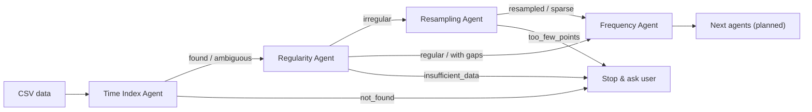

# Forecasting Agents

A demo of LLM-assisted agents that together form an end-to-end time series forecasting pipeline,
served as a Streamlit app that runs locally, in Docker, or on a Hugging Face Space.

Deterministic tools (pandas/numpy) compute every fact and rule-based logic makes every decision.
A small LLM (default `Qwen/Qwen2.5-0.5B-Instruct`, CPU) then explains what the result means,
so a tiny model never has to compute anything. The app's **Agents** tab shows the same
catalogue as below.

## Agents

<!-- AGENTS:START -->
<!-- generated by scripts/render_agents_md.py; do not edit by hand -->

**Design principle:** Deterministic tools compute every fact → rules make every decision → a small LLM only explains. No routing decision ever depends on LLM output.



### 1. Time Index Agent

Finds the column that holds the timestamps, the numeric column to forecast and, for long-format data, the column that identifies each series.

| Property | Details |
|---|---|
| Runs when | Always (first agent). |
| Inputs | Uploaded or sample CSV (any column names) |
| Outputs | Time column and how it was parsed (ISO, day-first, epoch s/ms, YYYYMMDD, mixed)<br>Ranked time-column candidates with parse rate and score<br>Target column<br>Series-id column and number of series (long format) |
| User controls | Time column<br>Target column<br>Series to analyse (long format) |
| Tools | `tools.time_index.detect_time_column`<br>`tools.time_index.parse_time_column` |

| Decision | Meaning |
|---|---|
| `found` | One clear time column; the pipeline continues. |
| `ambiguous` | Several plausible time columns; the best one is used, but you should confirm it. |
| `not_found` | No column parses as dates; the pipeline stops. |

### 2. Regularity Agent

Checks whether the timestamps follow a fixed frequency, including calendar frequencies (business days, month/quarter/year starts and ends), and flags duplicates, gaps and unsorted data.

| Property | Details |
|---|---|
| Runs when | After a time column is found. |
| Inputs | Parsed timestamps of one series |
| Outputs | Status and detected frequency alias<br>Coverage and share of timestamps on the grid<br>Missing-timestamp count, duplicate count, largest gap<br>Spacing statistics (min/median/max delta) |
| User controls | — |
| Tools | `tools.frequency.analyze_regularity` |

| Decision | Meaning |
|---|---|
| `regular` | Every timestamp sits on a fixed grid with no gaps. |
| `regular_with_gaps` | Fixed grid, but some timestamps are missing. |
| `irregular` | No fixed grid fits; the Resampling agent runs next. |
| `insufficient_data` | Fewer than 3 distinct timestamps; the pipeline stops. |

### 3. Resampling Agent

Converts irregularly spaced observations into a fixed-frequency series between 1 hour and 1 week, using your choice of frequency, aggregation and empty-bin handling.

| Property | Details |
|---|---|
| Runs when | Only when the Regularity agent says the series is irregular. |
| Inputs | Irregular series<br>Your resampling preferences (sidebar) |
| Outputs | Chosen frequency and whether it was yours or auto-recommended<br>Data points, bins and empty-bin share for every candidate frequency<br>The resampled series (replaces the raw one for later agents) |
| User controls | Target frequency: auto or h, 2h, 3h, 4h, 6h, 12h, D, 2D, 3D, W<br>Aggregation: mean, sum, median, min, max, first, last, count<br>Empty bins: leave missing, forward fill, interpolate, zero |
| Tools | `tools.resample.resample_options`<br>`tools.resample.recommend_freq`<br>`tools.resample.resample_series` |

| Decision | Meaning |
|---|---|
| `resampled` | Enough data points and few empty bins; the pipeline continues. |
| `sparse` | Enough points, but over half the bins are empty; a coarser frequency is suggested. |
| `too_few_points` | Fewer than 30 data points; finer frequencies are suggested and the pipeline stops. |

### 4. Frequency Agent

Names the sampling frequency in plain words and as a pandas alias, lists missing timestamps and gap runs, and proposes the seasonal periods later agents should test.

| Property | Details |
|---|---|
| Runs when | When a fixed frequency is known (detected by Regularity or produced by Resampling). |
| Inputs | Series with a known fixed frequency |
| Outputs | Pandas alias and label (e.g. 'h' / hourly)<br>Expected vs observed points and coverage<br>Longest gap runs and a sample of missing timestamps<br>Candidate seasonal periods (e.g. hourly: 24, 168) |
| User controls | — |
| Tools | `tools.frequency.describe_frequency` |

| Decision | Meaning |
|---|---|
| `<alias>` | The pandas frequency alias, e.g. h, D, B, W-SUN, MS, QS-JAN. The status is a warning if timestamps are missing. |
<!-- AGENTS:END -->

## Run with Docker

Two image variants are built from one multi-stage `Dockerfile`:

| Target | Contents | Use it for |
|---|---|---|
| `full` (default) | App + CPU PyTorch + transformers, with `Qwen2.5-0.5B-Instruct` baked in | The complete demo with LLM explanations |
| `lite` | App only, no PyTorch (`USE_LLM=0`) | A small, fast image with rule-based summaries only |

```bash
# full image
docker build -t fcagents .
docker run --rm -p 7860:7860 fcagents            # → http://localhost:7860

# lite image
docker build --target lite -t fcagents:lite .
docker run --rm -p 7860:7860 fcagents:lite

# docker compose (model cache persisted in a named volume)
docker compose up -d                             # full, port 7860
docker compose --profile lite up -d app-lite     # lite, port 7861
docker compose down

# end-to-end check: build, start, wait for health, run every sample through the agents
scripts/container_smoke_test.sh lite             # or: full
```

| Env var | Default | Meaning |
|---|---|---|
| `MODEL_ID` | `Qwen/Qwen2.5-0.5B-Instruct` | Default LLM. Other models download on first use into `/home/user/.cache/huggingface`. |
| `USE_LLM` | `1` (`0` in lite) | Whether the "Explain with an LLM" toggle starts on |
| `STREAMLIT_SERVER_PORT` | `7860` | Port the app listens on inside the container |
| `PORT` (compose only) | `7860` | Host port mapped to the full service |

Build arg `PRELOAD_MODEL` chooses which model is baked into the `full` image,
for example `--build-arg PRELOAD_MODEL=Qwen/Qwen2.5-1.5B-Instruct`.
The container runs as uid 1000 and exposes a Docker `HEALTHCHECK` on `/_stcore/health`.
The same image runs unchanged as a Hugging Face Docker Space; the frontmatter above sets `app_port: 7860`.

## Run locally

```bash
uv sync --extra llm                      # drop --extra llm for a rule-only install
uv run streamlit run app.py
uv run pytest                            # fast tests (no model)
uv run pytest -m slow                    # also loads the real LLM
```

## Layout

```
app.py                       Streamlit UI (rendering only): "Run pipeline" and "Agents" tabs
src/fcagents/tools/          deterministic tools (time_index, frequency, resample)
src/fcagents/agents/         one agent per pipeline step, each carrying its own catalogue metadata
src/fcagents/core/           BaseAgent / AgentResult / PipelineState
src/fcagents/llm/            LLM backends (transformers on CPU, or none)
src/fcagents/orchestrator.py pipeline order and routing
src/fcagents/catalog.py      agent catalogue: app tab, README section, flow diagram
scripts/                     sample generator, README renderer, container smoke test
```

## Adding an agent

Subclass `BaseAgent`, then:

1. Implement `run_tools(state)`, which returns JSON facts.
2. Implement `decide(facts)`, which returns a `Decision`.
3. Optionally implement `prompt_facts(facts)` to trim what the LLM sees.
4. Fill in the catalogue metadata: `summary`, `runs_when`, `inputs`, `outputs`, `decisions`, `user_controls`, `tools`.

Add the agent to `PIPELINE` in the orchestrator. Override `applies(state)` if it only runs in some
situations, and add a routing rule if it can stop the pipeline. Add its edges to `EDGES` in
`catalog.py`, then run `uv run python scripts/render_agents_md.py` to refresh this README.
A test fails if the README is out of date.
