# Forecasting Agents

A demo of LLM-assisted agents that together form an end-to-end time series forecasting pipeline,
served as a Gradio app that runs locally, in Docker, or on a Hugging Face ZeroGPU Space.

Deterministic tools (pandas/numpy) compute every fact and rule-based logic makes every decision.
An LLM then explains what the result means, so the model never has to compute anything. You choose the LLM in
the sidebar. Locally, that is a small model running inside the app on CPU (default `Qwen/Qwen2.5-0.5B-Instruct`) or
a model you serve yourself with Ollama, vLLM or LM Studio. On the Hugging Face Space the same small model runs on
ZeroGPU (free), and you can also use any chat model
served by [Hugging Face Inference Providers](https://huggingface.co/docs/inference-providers), called with
**your own** Hugging Face token (see [Language model & tokens](#language-model--tokens)). The app's **Agents** tab shows the same
catalogue as below.

## Pages & chat

The language model and the data source sit at the top of the sidebar. The pipeline runs as one tab per step,
with Back/Next buttons and a step bar that shows each step's status:

| Page | Agents | What you can change |
|---|---|---|
| 1 · Data | Time Index, Regularity | time column, target column, series (long format) |
| 2 · Resampling | Resampling, Frequency | target frequency (1h – 1W), aggregation per bin |
| 3 · Holidays | Holidays | country and state (default US), official / unofficial holidays, days before and after (0–14); download the suggested holiday covariates |
| 4 · Outliers | Outliers | sensitivity; per flagged point: keep, remove or replace with another value (or apply the suggestions to all) |
| 5 · Missing values | Missing Values | fill method; download the prepared series (with holiday covariates) as CSV |
| Agents | — | the catalogue below |

Each page opens with a **chat**. You can type a change instead of using the controls, or ask about the series:

| Page | Example prompts |
|---|---|
| Data | “use temp as the target”, “switch to store_2”, “how many points are there?” |
| Resampling | “resample to 6 hours with sum”, “daily, max per day”, “what is the mean?” |
| Holidays | “use Germany”, “only California”, “include unofficial holidays”, “check 3 days around holidays” |
| Outliers | “apply the suggestions”, “remove all outliers”, “keep them all”, “be more sensitive” |
| Missing values | “fill gaps by interpolation”, “use seasonal filling”, “how many values were filled?” |

The chat keeps to the same principle as the agents:

1. **Rules first.** A rule parser maps the prompt to the page's settings.
2. **LLM proposals are checked and confirmed.** Only if the rules find nothing, the LLM proposes a JSON setting
   change. It is kept only if it names a setting of this page and one of its allowed values (a frequency outside
   1h – 1W is refused). A 0.5B model can still misread the intent, so the proposal waits for you to click
   **Apply** or **Dismiss**.
3. **Answers come from computed facts.** Common questions (points, missing values, mean, min/max, start/end,
   frequency) get a template answer from computed stats. Other questions are phrased by the LLM from those stats and
   the page's agent facts only. Without an LLM, the stats are shown as a table.

Every reply says whether it came from the rules or the LLM. A setting changed in chat updates the page's controls,
re-runs that step and is kept when you switch pages.

## Agents

<!-- AGENTS:START -->
<!-- generated by scripts/render_agents_md.py; do not edit by hand -->

**Design principle:** Deterministic tools compute every fact → rules make every decision → a small LLM only explains. No routing decision ever depends on LLM output.

```mermaid
flowchart LR
  data["CSV data"]
  time_index["Time Index Agent"]
  regularity["Regularity Agent"]
  resampling["Resampling Agent"]
  frequency["Frequency Agent"]
  holidays["Holidays Agent"]
  outliers["Outliers Agent"]
  missing_values["Missing Values Agent"]
  stop["Stop & ask user"]
  next["Next agents (planned)"]
  data --> time_index
  time_index -->|found / ambiguous| regularity
  time_index -->|not_found| stop
  regularity -->|irregular / you pick a frequency| resampling
  regularity -->|regular / with gaps| frequency
  regularity -->|insufficient_data| stop
  resampling -->|resampled / sparse| frequency
  resampling -->|too_few_points| stop
  frequency --> holidays
  holidays -->|holiday days are protected| outliers
  outliers -->|removed points become gaps| missing_values
  missing_values --> next
```



### 1. Time Index Agent

Finds the column that holds the timestamps, the numeric column to forecast and, for long-format data, the column that identifies each series.

| Property | Details |
|---|---|
| Page | Data |
| Runs when | Always (first agent). |
| Inputs | Uploaded or sample CSV (any column names) |
| Outputs | Time column and how it was parsed (ISO, day-first, epoch s/ms, YYYYMMDD, mixed)<br>Ranked time-column candidates with parse rate and score<br>Target column<br>Series-id column and number of series (long format) |
| User controls | Time column<br>Target column<br>Series to analyse (long format) |
| Tools | `tools.time_index.detect_time_column`<br>`tools.time_index.parse_time_column` |

| Decision | Meaning |
|---|---|
| `found` | One clear time column; the pipeline continues. |
| `ambiguous` | Several plausible time columns; the best one is used, but you should confirm it. |
| `not_found` | No column parses as dates; the pipeline stops. |

### 2. Regularity Agent

Checks whether the timestamps follow a fixed frequency, including calendar frequencies (business days, month/quarter/year starts and ends), and flags duplicates, gaps and unsorted data.

| Property | Details |
|---|---|
| Page | Data |
| Runs when | After a time column is found. |
| Inputs | Parsed timestamps of one series |
| Outputs | Status and detected frequency alias<br>Coverage and share of timestamps on the grid<br>Missing-timestamp count, duplicate count, largest gap<br>Spacing statistics (min/median/max delta) |
| User controls | — |
| Tools | `tools.frequency.analyze_regularity` |

| Decision | Meaning |
|---|---|
| `regular` | Every timestamp sits on a fixed grid with no gaps. |
| `regular_with_gaps` | Fixed grid, but some timestamps are missing. |
| `irregular` | No fixed grid fits; the Resampling agent runs next. |
| `insufficient_data` | Fewer than 3 distinct timestamps; the pipeline stops. |

### 3. Resampling Agent

Converts irregularly spaced observations into a fixed-frequency series between 1 hour and 1 week, using your choice of frequency and aggregation. Empty bins are left as missing timestamps for the Missing Values agent.

| Property | Details |
|---|---|
| Page | Resampling |
| Runs when | When the Regularity agent says the series is irregular, or when you pick a frequency for a regular series (e.g. aggregate hourly data to daily). |
| Inputs | Series from the Data page<br>Your resampling preferences (page controls or chat) |
| Outputs | Chosen frequency and whether it was yours or auto-recommended<br>Data points, bins and empty-bin share for every candidate frequency<br>The resampled series, empty bins dropped (replaces the raw one for later agents) |
| User controls | Target frequency: auto or h, 2h, 3h, 4h, 6h, 12h, D, 2D, 3D, W (controls or chat)<br>Aggregation: mean, sum, median, min, max, first, last, count (controls or chat) |
| Tools | `tools.resample.resample_options`<br>`tools.resample.recommend_freq`<br>`tools.resample.resample_series` |

| Decision | Meaning |
|---|---|
| `resampled` | Enough data points and few empty bins; the pipeline continues. |
| `sparse` | Enough points, but over half the bins are empty; a coarser frequency is suggested. |
| `too_few_points` | Fewer than 30 data points; finer frequencies are suggested and the pipeline stops. |

### 4. Frequency Agent

Names the sampling frequency in plain words and as a pandas alias, lists missing timestamps and gap runs, and proposes the seasonal periods later agents should test.

| Property | Details |
|---|---|
| Page | Resampling |
| Runs when | When a fixed frequency is known (detected by Regularity or produced by Resampling). |
| Inputs | Series with a known fixed frequency |
| Outputs | Pandas alias and label (e.g. 'h' / hourly)<br>Expected vs observed points and coverage<br>Longest gap runs and a sample of missing timestamps<br>Candidate seasonal periods (e.g. hourly: 24, 168) |
| User controls | — |
| Tools | `tools.frequency.describe_frequency` |

| Decision | Meaning |
|---|---|
| `<alias>` | The pandas frequency alias, e.g. h, D, B, W-SUN, MS, QS-JAN. The status is a warning if timestamps are missing. |

### 5. Holidays Agent

Compares each holiday, and the days around it, with a same-weekday baseline to find out whether holidays move the series. If they do, it suggests holiday covariates for the forecasting model and tells the Outliers agent to leave those days alone.

| Property | Details |
|---|---|
| Page | Holidays |
| Runs when | When a fixed frequency of one day or finer is known and the series has values (after Frequency). |
| Inputs | Fixed-frequency series (daily or finer)<br>Country and state, official and/or unofficial holidays, days around each holiday (page or chat) |
| Outputs | Holidays in the data and whether they move the series (overall test and per holiday)<br>Effects on the days before and after a holiday (e.g. a shopping run-up)<br>Suggested 0/1 covariates: is_holiday plus one column per detected effect (CSV download)<br>Holiday-affected days, which the Outliers agent never flags |
| User controls | Country (default United States) and state / region<br>Holiday types: Official (public holidays), Unofficial (observances, other days)<br>Days before and after each holiday to check (0–14, default 7) |
| Tools | `tools.holidays.holiday_calendar`<br>`tools.holidays.holiday_impact`<br>`tools.holidays.holiday_covariates` |

| Decision | Meaning |
|---|---|
| `impact` | Holidays move the series. Use the suggested holiday covariates in the forecasting model. |
| `window_impact` | The holidays themselves look normal, but the days around them move. Use the before/after covariates. |
| `no_impact` | No holiday stands out from ordinary days; holiday covariates are not needed. |
| `too_few_holidays` | Fewer than 3 holidays fall inside the data, too few to judge. |
| `not_applicable` | The frequency is coarser than a day (weeks, months), so single days can't be seen. |

### 6. Outliers Agent

Compares every value with what the trend and seasonal pattern predict and flags the ones that are far off. You decide per point: keep it, remove it (the Missing Values agent then fills the gap) or replace it with another value. Nothing changes until you choose.

| Property | Details |
|---|---|
| Page | Outliers |
| Runs when | When a fixed frequency is known and the series has values (after the Holidays agent). |
| Inputs | Fixed-frequency series<br>Holiday-affected days from the Holidays agent<br>Sensitivity and your keep / remove / replace choices (page or chat) |
| Outputs | Flagged points with their value, expected value and robust z-score<br>A suggestion per point (replace when |z| ≥ 5, otherwise keep)<br>Holiday-affected points that were left alone<br>The series with your choices applied (removed points become gaps for the Missing Values agent) |
| User controls | Sensitivity: High (|z| > 3), Normal (|z| > 3.5), Low (|z| > 5)<br>Per point: Keep / Remove / Replace with a replacement value<br>All at once: keep all, remove all, replace all, apply suggestions (buttons or chat) |
| Tools | `tools.outliers.detect_outliers`<br>`tools.outliers.apply_outlier_actions` |

| Decision | Meaning |
|---|---|
| `none_found` | No value is far from the expected pattern. |
| `flagged` | Some values look like outliers and you haven't decided about all of them yet; they are kept until you do. |
| `handled` | You decided about every flagged point; your choices are applied. |

### 7. Missing Values Agent

Puts the series on its complete fixed-frequency grid, counts missing timestamps and empty values, and fills them with your chosen method or a rule-based recommendation.

| Property | Details |
|---|---|
| Page | Missing values |
| Runs when | When a fixed frequency is known and the series has values (after the Frequency agent). |
| Inputs | Fixed-frequency series (regular, or resampled with empty bins dropped)<br>Your fill method (page control or chat) |
| Outputs | Missing timestamps, missing values and the share of the grid they cover<br>Longest gap runs, duplicates merged, off-grid timestamps dropped<br>Fill method and whether it was yours or auto-recommended<br>The complete, filled series (replaces the previous one for later agents) |
| User controls | Fill method: auto, leave missing, forward fill, backward fill, interpolate in time, zero, seasonal naive (value one season earlier) (control or chat) |
| Tools | `tools.missing.missing_report`<br>`tools.missing.recommend_fill`<br>`tools.missing.fill_missing` |

| Decision | Meaning |
|---|---|
| `complete` | Nothing is missing; the series is ready as is. |
| `filled` | Every missing value was filled. |
| `long_gaps` | Filled, but a gap is longer than one season (or 24 steps) or over 30% of the grid was missing, so the filled values are guesswork. |
| `left_missing` | Some values are still missing (method 'leave missing'); most forecasting models need a complete series. |
<!-- AGENTS:END -->

## Run with Docker

Two image variants are built from one multi-stage `Dockerfile`:

| Target | Contents | Use it for |
|---|---|---|
| `full` (default) | App + CPU PyTorch + transformers, with `Qwen2.5-0.5B-Instruct` baked in | The complete demo with LLM explanations |
| `lite` | App only, no PyTorch (`USE_LLM=0`, `LLM_BACKEND=server`) | A small, fast image: rule-based summaries, or your own LLM server |

```bash
# full image
docker build -t fcagents .
docker run --rm -p 7860:7860 fcagents            # → http://localhost:7860

# lite image
docker build --target lite -t fcagents:lite .
docker run --rm -p 7860:7860 fcagents:lite

# docker compose (model cache persisted in a named volume)
docker compose up -d                             # full, port 7860
docker compose --profile lite up -d app-lite     # lite, port 7861
docker compose down

# end-to-end check: build, start, wait for health, run every sample through the agents
scripts/container_smoke_test.sh lite             # or: full
```

| Env var | Default | Meaning |
|---|---|---|
| `LLM_BACKEND` | `local` (`server` in lite) | Backend selected when the app opens: `local` (in-app CPU model), `server` (your LLM server; not on a Space) or `api` (Inference Providers with the user's token; Space only) |
| `LOCAL_LLM_URL` | `http://localhost:11434/v1` (`http://host.docker.internal:11434/v1` in Docker) | OpenAI-compatible server for the `server` backend |
| `LOCAL_LLM_MODEL` | `qwen2.5:0.5b` | Model picked first on that server, if it has it |
| `MODEL_ID` | `Qwen/Qwen2.5-0.5B-Instruct` | Default local model. Others typed in the sidebar download on first use into `/home/user/.cache/huggingface`. |
| `HF_API_MODEL` | `Qwen/Qwen2.5-7B-Instruct` | Default hosted model for the `api` backend; users can type any other model id |
| `USE_LLM` | `1` (`0` in lite) | Whether the "Use an LLM" toggle starts on |
| `GRADIO_SERVER_PORT` | `7860` | Port the app listens on inside the container |
| `PORT` (compose only) | `7860` | Host port mapped to the full service |

Build arg `PRELOAD_MODEL` chooses which model is baked into the `full` image,
for example `--build-arg PRELOAD_MODEL=Qwen/Qwen2.5-1.5B-Instruct`.
The container runs as uid 1000 and exposes a Docker `HEALTHCHECK` on `/`.
The Docker image is for running the app yourself; the Hugging Face Space uses the Gradio SDK (see below).

## Language model & tokens

Which backends the sidebar offers depends on where the app runs. The app detects a Space by the `SPACE_ID`
variable that Hugging Face sets.

| Backend | Where | Model | Token |
|---|---|---|---|
| ZeroGPU model | ZeroGPU Space only | The app's own model (`MODEL_ID`), loaded at startup | None. Uses the visitor's free ZeroGPU quota |
| Local model (in-app, CPU) | Local runs and non-ZeroGPU Spaces | Any public chat model id (default `MODEL_ID`) | None. Downloads use `token=False`, so a host token is never sent |
| Local LLM server | Local runs only | Any model your Ollama, vLLM or LM Studio server lists at `LOCAL_LLM_URL` | None. A dummy key is sent, never `HF_TOKEN` |
| Hugging Face API | Hugging Face Space only | Any model served by Inference Providers (default `HF_API_MODEL`), plus a provider | The visitor's own token, billed to their HF account |

Local runs never show a token field. The server option is left out on the Space, because a URL field on a public
app would let visitors make the server call any host.

**Use Ollama locally:**
```bash
ollama pull qwen2.5:0.5b          # any model works; the sidebar lists what the server has
uv run python app.py              # then pick “Local LLM server” in the sidebar
```

**Tokens always belong to the user, never to the app.** The hosted backend is built only from the token typed into the
sidebar. It never reads `HF_TOKEN`, a cached `hf auth login` or a Space secret, so if no token is pasted, the app
falls back to rule-based summaries. The token is kept in that browser session's state only. It is not written to
disk, logs, env vars or the cache shared between visitors, and it is masked in error messages.

To get a token, open <https://huggingface.co/settings/tokens>, create a **fine-grained** token, and tick
**“Make calls to Inference Providers”**.

## Deploy to a Hugging Face Space

The Space runs on **ZeroGPU** with the **Gradio** SDK, which free accounts can host. The frontmatter at the top of
this README configures it (`sdk: gradio`, `app_file: app.py`), and `requirements.txt` lists what the Space installs
(Gradio, `spaces`, `huggingface_hub` and PyTorch are provided by the platform).

1. Create a Space at <https://huggingface.co/new-space>: SDK **Gradio**, hardware **ZeroGPU**.
2. GitHub Actions pushes `main` to the Space after CI passes (`.github/workflows/sync-to-hf.yml`). Add a write token
   as the repository secret `HF_TOKEN` and set the Space id in that workflow. Or push by hand:
   ```bash
   git remote add space https://huggingface.co/spaces/<your-user>/<space-name>
   git push space main          # authenticate with your HF username + a write token
   ```
3. Optional: under *Settings → Variables*, set `LLM_BACKEND` (`zerogpu` or `api`), `HF_API_MODEL`, `MODEL_ID` or
   `USE_LLM`. These are plain **variables**. **Do not add an `HF_TOKEN` secret to the Space.** The app ignores it for
   LLM calls by design, because every visitor uses their own token.
4. Open the Space. The ZeroGPU model explains the results out of the box; visitors can switch to
   **Hugging Face API (your token)** for larger models.

## Run locally

```bash
uv sync --extra llm                      # drop --extra llm for a rule-only install
uv run python app.py                     # → http://localhost:7860
uv run pytest                            # fast tests (no model)
uv run pytest -m slow                    # also loads the real LLM
```

## Layout

```
app.py                       Gradio entry (imports the ZeroGPU model first on a ZeroGPU Space)
src/fcagents/webui.py        Gradio UI: sidebar, one tab per step, result cards, charts, chat
src/fcagents/session.py      one visitor's state: data, settings, cached stage results, chat (no UI code)
src/fcagents/chat/           page chat: rule parser, validated LLM router, stats-grounded answers
src/fcagents/tools/          deterministic tools (time_index, frequency, resample, missing)
src/fcagents/agents/         one agent per pipeline step, each carrying its own catalogue metadata
src/fcagents/core/           BaseAgent / AgentResult / PipelineState
src/fcagents/llm/            LLM backends (ZeroGPU model, in-app CPU model, local OpenAI-compatible server, HF Inference Providers with the user's token, or none)
src/fcagents/orchestrator.py stages (one per page), pipeline order and routing
src/fcagents/catalog.py      agent catalogue: app tab, README section, flow diagram
scripts/                     sample generator, README renderer, container smoke test
```

## Adding an agent

Subclass `BaseAgent`, then:

1. Implement `run_tools(state)`, which returns JSON facts.
2. Implement `decide(facts)`, which returns a `Decision`.
3. Optionally implement `prompt_facts(facts)` to trim what the LLM sees.
4. Fill in the catalogue metadata: `summary`, `runs_when`, `inputs`, `outputs`, `decisions`, `user_controls`, `tools`.

Add the agent to a stage in `STAGES` in the orchestrator (a new stage also needs a page in `views/`,
its settings in `chat/actions.py` and its words in `chat/parser.py`). Override `applies(state)` if it only runs in some
situations, and add a routing rule if it can stop the pipeline. Add its edges to `EDGES` in
`catalog.py`, then run `uv run python scripts/render_agents_md.py` to refresh this README.
A test fails if the README is out of date.

## License

Apache License 2.0 — see [LICENSE](LICENSE).
